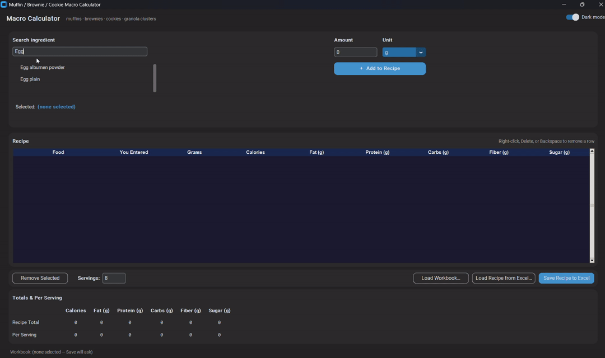
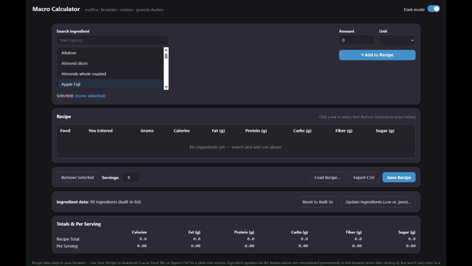

# Muffin Macro Calculator and Recipe Builder for Carb Sensitive Bakers
## From Excel workbook to standalone apps with python's Tkinter and HTML file
## Overview of the Problem
This project started as an [Excel workbook](https://github.com/SandyGCabanes/Muffin-Macro-Calculator-and-Recipe-Builder/blob/main/Muffin%20recipe%20builder.xlsx) that I built to be able to adjust the macros in the muffin recipe to achieve target protein grams, fat grams and carb grams. I am carb-sensitive, so I need to watch my carb and sugar intake but at the same time still enjoy the muffins that I bake.  My workbook did its job well, but over time I ran into some practical limitations.

The Excel workbook solution required opening files from cloud storage, and involved navigating a large worksheet using both horizontal and vertical scrolling. It worked, but it wasn't particularly convenient or portable.

I needed to shift from Excel to something more automated. The goal was to **keep the functionality but remove the friction.**   It should be able to run locally, or on the github pages, process data on the fly, and export new recipes without firing up Excel.

I rebuilt the solution in two different ways:

- A [standalone desktop application](https://github.com/SandyGCabanes/Muffin-Macro-Calculator-and-Recipe-Builder/blob/main/muffin_recipe_builder_v5.py) using **Python and Tkinter**

- A [standalone browser application](https://sandygcabanes.github.io/Muffin-Macro-Calculator-and-Recipe-Builder/) using **HTML, CSS, and JavaScript**

---
***Excel workbook macros calculator and recipe builder → Python standalone app →  HTML standalone app***

---

## Evolution of the Solution
### Excel Workbook
The project originally existed as an Excel workbook containing the calculations, input rules, and workflow.  A lot of it was human-initiated.

This original Excel version served as the reference implementation throughout the project.

### Python Desktop Application
The first migration moved the workbook's functionality into a [standalone desktop application](https://github.com/SandyGCabanes/Muffin-Macro-Calculator-and-Recipe-Builder/blob/main/muffin_recipe_builder_v5.py) built with Python and Tkinter.  The first few versions used the standard Tkinter package. From version 4 onwards, custom Tkinter package was used for better visuals.

*Benefits of the python app:*

- Remove the Excel dependency, preserve existing calculation logic

- Simplify distribution  (Tkinter app could be launched locally)

- Improve usability (no more scrolling in the phone)

- Previous recipes can be uploaded, and new recipes can be saved as local files

All these benefits were delivered.  My [envisioned design](https://github.com/SandyGCabanes/Muffin-Macro-Calculator-and-Recipe-Builder/blob/main/big_picture_diagram.md) was to keep the ingredients.csv file small, since I have a limited set of baking ingredients.  For example, eggs are eggs, no small/medium/large options. 

### Browser-Based Application
After validating the desktop approach, I created a [standalone HTML and JavaScript version.](https://sandygcabanes.github.io/Muffin-Macro-Calculator-and-Recipe-Builder/) The initial versions had a separate python code to update the embedded ingredients in the html, transforming the csv to json that the html imports. The new version merged these into a single html file that pulls the csv file directly and converts it as an object within the html file, without requiring a json file.  

*Benefits of the html app:*

- Open the application directly in a browser, which imports the CSV data directly

- Perform calculations locally, and avoid server infrastructure

- Avoid database dependencies by using a small csv file imported into the html file

- Avoid cloud dependencies

- Upload old recipes and tweak them, save new recipes locally

All these benefits were delivered by the html app. The CSS section is deliberately embedded within the html and not a separate standalone import. This was a design choice.

## Development Process
This project evolved through many rounds of iteration.

The process generally looked like this:

1. Define a requirement or pain point.

2. Build a working solution.

3. Test it against the original Excel implementation.

4. Identify usability or design issues.

5. Refine and repeat.

I explored many implementation approaches until I settled on the final design.

The finished application reflects numerous small decisions made throughout development, including interface design, workflow simplification, calculation validation, file handling, and documentation.

## Data Lineage Documentation
As the project evolved, I wanted documentation that clearly showed how data moved through the application and how calculations were derived.

To accomplish this, I created a series of data lineage diagrams using Mermaid.

The first attempts generated very large diagrams that contained all relationships in a single view. While technically complete, they were difficult to understand and resembled a dense dependency web.

After several iterations, the diagrams were reorganized into smaller functional sections.

This made it easier for anyone to:

- Understand data flow

- Trace calculation dependencies

- Maintain documentation

- Explain the system to new users

The [lineage diagrams](https://github.com/SandyGCabanes/Muffin-Macro-Calculator-and-Recipe-Builder/blob/main/lineage_diagram_index_v2.md) are intended to **document the application's behavior** in a way that is **useful to everyone.**

## Validation
Each implementation was compared against the original Excel workbook to confirm that calculations and outputs remained consistent.   I have used the Excel workbook for more than a year, so I know what items to validate.

Validation focused on:

- Calculation accuracy, small decimal discrepancies allowed due to rounding off

- UI designs, buttons and functionalities, consistent with the Excel design

- Data transformation logic, based on default grams per volume

- Expected outputs in the full UI

## Technical Characteristics

### Python Version
- Standalone desktop application

- Built with Tkinter

- Local file processing

- No Excel dependency

- No server dependency

  
### HTML Version
- Single-file application

- CSV import support

- Client-side JavaScript processing

- No server required

- No database required

- No installation required

- Local execution

- Cross-platform browser compatibility

## AI-Assisted Development and Documentation

I used **AI-assisted development tools** throughout this project to help generate and refine code, documentation, and Mermaid diagrams.

Development was highly iterative.  I reviewed generated outputs, tested them, revised them and compared them against the original Excel functions and features before approving the final versions.

 

The [lineage documentation](lineage_diagram_index_v2.md) also went through several iterations before arriving at a structure that balanced technical completeness with human readability.
