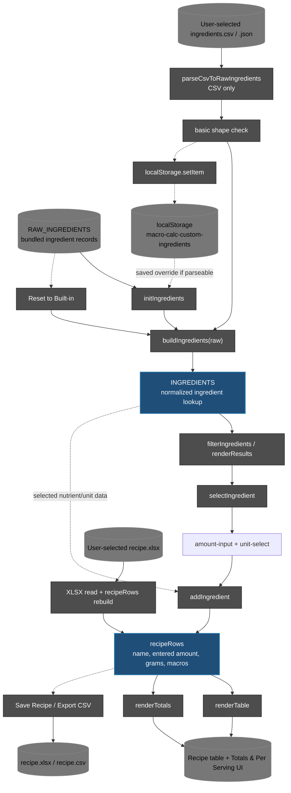
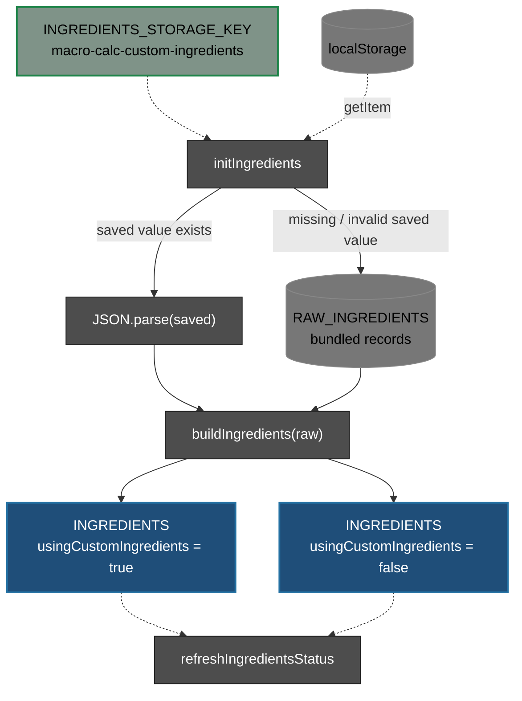
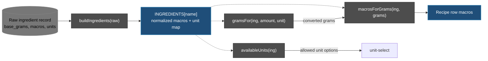
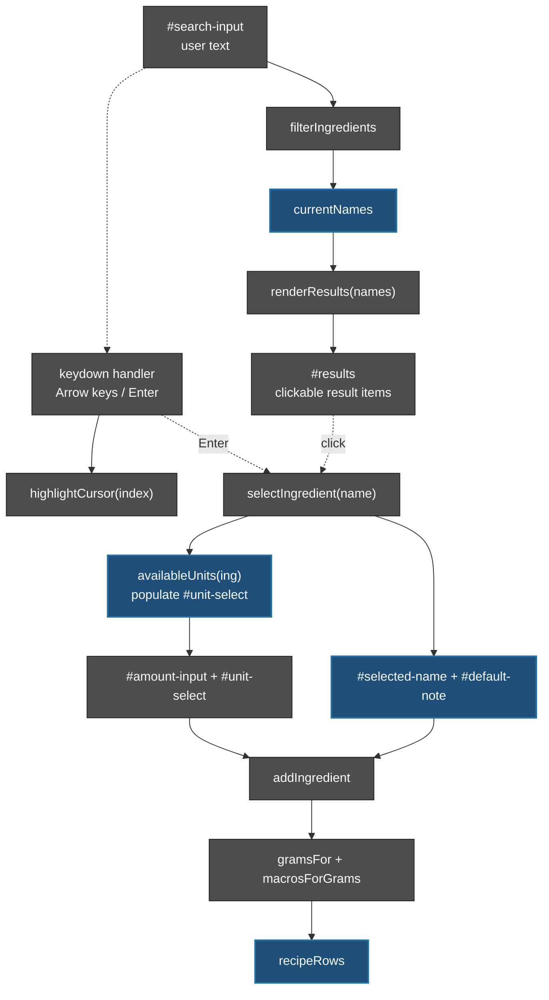
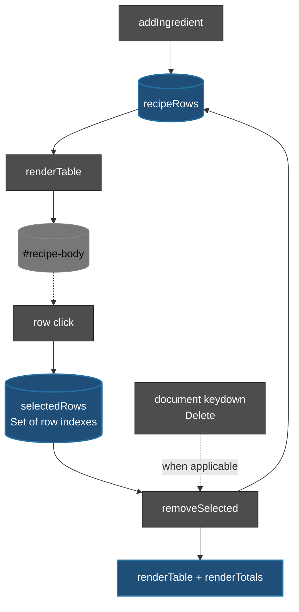
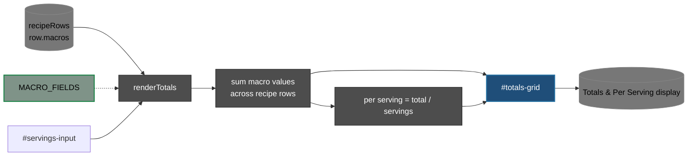
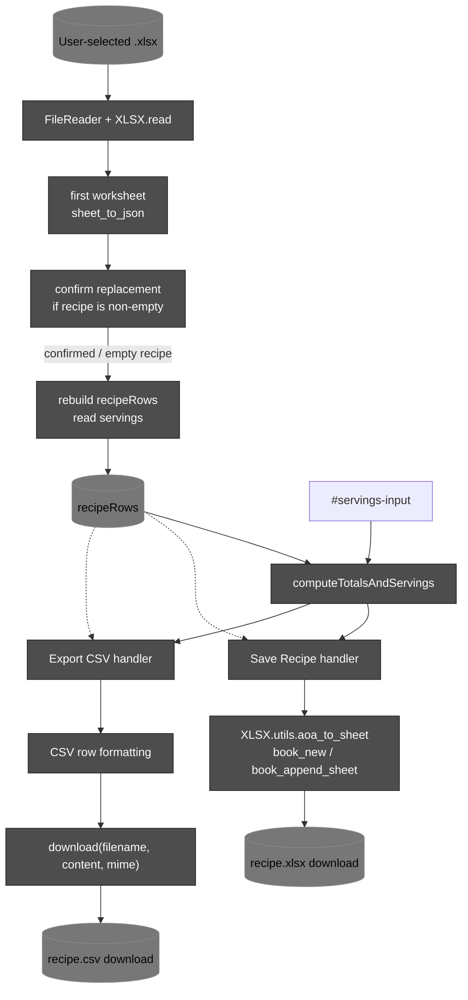
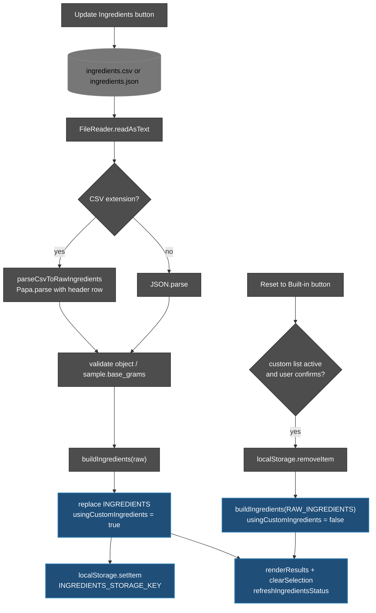
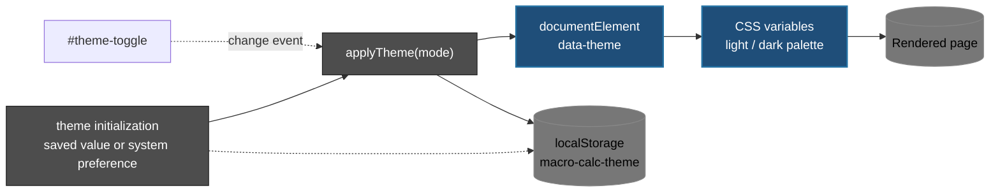

# Lineage of the index_v2.0.html macro calculator

This document maps the single-page macro calculator in `index_v2.0.html`: its bundled ingredient data, recipe state, calculations, user-interface rendering, browser storage, and import/export paths.

The page is a self-contained HTML/CSS/JavaScript application rather than a multi-stage build. The JavaScript is organized as a sequence of data transformations and event handlers inside one `<script>` block. It uses two external browser libraries: SheetJS (`xlsx`) for Excel recipe files and Papa Parse for ingredient CSV files.

---

**Main flow:**

`built-in or saved ingredient data -> normalized INGREDIENTS -> search and selection -> recipeRows -> macro totals -> page display / downloaded files`

The ingredient data are imported as objects:

**RAW_INGREDIENTS** <- Source object: original nutritional values

     
**buildIngredients(RAW_INGREDIENTS)** <- Transforms data and precomputes macros per gram

     
**INGREDIENTS** <- Runtime dictionary: used for ingredient lookup and calculations

---

**How to read this document**

- Boxes name real elements, functions, variables, constants, or data sources in `index_v2.0.html`.
- Solid arrows show data flow or a state transition; dotted arrows show a read, call, configuration dependency, or event binding.
- Browser `localStorage` is persistent only for the current browser profile and origin. It is not a server-side database.
- The page's ingredient macro fields are `calories`, `fat_g`, `protein_g`, `carbs_g`, `fiber_g`, and `sugar_g`.
- The file has no separate modules or build stages: the diagrams group related code paths for readability.
- Line references below refer to the uploaded `index_v2.0.html` file.

**Legend**

- Grey disc: external or browser-managed input/output.
- Dark grey box: function or runtime operation.
- Green box: constant, setting, or browser storage key.
- Blue box: derived data or application state.
- Solid arrow: data flows to the next step.
- Dotted arrow: reads, calls, or triggers.
- A browser download is initiated client-side; the page does not upload recipe data.

---

**Contents**

- [Big picture](#big-picture)
- [Data index](#data-index)
- [Ingredient initialization and normalization](#ingredient-initialization-and-normalization)
- [Ingredient search and unit conversion](#ingredient-search-and-unit-conversion)
- [Recipe state and table rendering](#recipe-state-and-table-rendering)
- [Macro totals and per-serving calculation](#macro-totals-and-per-serving-calculation)
- [Recipe import and export](#recipe-import-and-export)
- [Ingredient data update and reset](#ingredient-data-update-and-reset)
- [Theme and presentation](#theme-and-presentation)
- [Element and function index](#element-and-function-index)
- [External dependencies](#external-dependencies)
- [Design notes and boundaries](#design-notes-and-boundaries)

---

## Big picture

The page starts by choosing ingredient data from browser storage when a valid saved override exists; otherwise it uses `RAW_INGREDIENTS` bundled in the HTML. `buildIngredients` converts raw nutrient values into normalized per-gram values and unit maps. Search lets a user select an ingredient, enter an amount and unit, and add a calculated row to `recipeRows`. Rendering functions update the recipe table and the totals/per-serving display. Recipe data can be downloaded as `.xlsx` or `.csv`, and a previously saved `.xlsx` can be loaded. Ingredient data can be replaced from `.csv` or `.json` and saved in local storage, or reset to the bundled list.

**Diagram 1. Runtime lineage**

The main recipe state is in memory in `recipeRows`; it is not automatically persisted. The ingredient override and theme preference are persisted separately in `localStorage`. Export creates a download; it does not save the recipe automatically in browser storage.

[Back to top](#lineage-of-the-index_v20html-macro-calculator)

---

## Data index

### 1. Raw ingredient records

`RAW_INGREDIENTS` is a JavaScript object embedded in the page. Each ingredient is keyed by its display name and includes:

| Field | Purpose |
|---|---|
| `base_grams` | Gram basis associated with the record's macro values |
| `calories` | Calories for the record's base quantity |
| `fat_g` | Fat in grams for the base quantity |
| `protein_g` | Protein in grams for the base quantity |
| `carbs_g` | Carbohydrates in grams for the base quantity |
| `fiber_g` | Fiber in grams for the base quantity |
| `sugar_g` | Sugar in grams for the base quantity |
| `meal_type` | Ingredient grouping metadata |
| `default_g_volume` | Human-readable reference quantity |
| `food_type` | Ingredient type metadata |
| `units` | Optional unit-to-gram conversion map, such as `tbsp`, `tsp`, `cup`, or `piece` |

The raw data is bundled in the HTML; it is not loaded from `ingredients.csv` automatically. The CSV is used only when the user chooses **Update Ingredients**.

### 2. Normalized `INGREDIENTS`

`buildIngredients(raw)` constructs the runtime lookup used by the UI and calculations. For each ingredient it derives a per-gram macro representation from the record's macro values and `base_grams`, and preserves unit conversion data for amount conversion. The exact normalized structure is defined by this function.

`INGREDIENTS` is initialized once at startup and can be replaced by an imported ingredient file or reset to the built-in data.

### 3. Recipe rows

Each item in `recipeRows` has this shape, as used by `addIngredient`, rendering, totals, and exports:

| Field | Meaning |
|---|---|
| `name` | Ingredient display name |
| `entered` | User-entered amount and unit representation |
| `grams` | Converted gram quantity |
| `macros` | Calculated values for all six `MACRO_FIELDS` |

`selectedRows` is a `Set` of selected row indexes used for row selection and removal. `currentNames` and `cursorIndex` support search-result keyboard navigation.

### 4. Macro fields and units

`MACRO_FIELDS` defines the six output measures in this order: Calories, Fat (g), Protein (g), Carbs (g), Fiber (g), Sugar (g). `UNIT_ORDER` defines the preferred unit order: `g`, `tbsp`, `tsp`, `cup`, `piece`.

The recipe table's column headings are `Food`, `You Entered`, `Grams`, followed by the six macro headings. The same field order is used by both exports.

### 5. Persistent browser keys

| Key | Stored value | Written/read by |
|---|---|---|
| `macro-calc-custom-ingredients` (`INGREDIENTS_STORAGE_KEY`) | Raw custom ingredient object serialized as JSON | `initIngredients`, ingredient update handler, reset handler |
| `macro-calc-theme` | Theme mode string (`light` or `dark`) | Theme initialization and `applyTheme` |

Recipe rows and servings are not saved automatically; the user downloads a recipe workbook or CSV to keep a recipe.

[Back to top](#lineage-of-the-index_v20html-macro-calculator)

---

## Ingredient initialization and normalization

Startup calls `initIngredients`. It first attempts to read `macro-calc-custom-ingredients` from `localStorage`; if a stored value parses and can be normalized, the page uses it and marks `usingCustomIngredients = true`. If no saved value exists or parsing/normalization fails, it falls back to `RAW_INGREDIENTS`.

**Takes.** Saved raw ingredient JSON if available, otherwise `RAW_INGREDIENTS`.

**Returns.** Runtime `INGREDIENTS`, plus the `usingCustomIngredients` flag.

**Downstream use.** Search, ingredient selection, unit choices, macro calculations, and ingredient status text.

**Diagram 2. Ingredient initialization**

### `buildIngredients(raw)`

This function is the normalization boundary between raw ingredient records and the runtime lookup. The UI and calculation functions use `INGREDIENTS`, not the raw records directly. `availableUnits(ing)` reads the available unit map, `gramsFor(ing, amount, unit)` converts the chosen quantity to grams, and `macrosForGrams(ing, grams)` computes macro amounts for that gram quantity.

**Diagram 3. Normalization and quantity calculations**

[Back to top](#lineage-of-the-index_v20html-macro-calculator)

---

## Ingredient search and unit conversion

The search box filters ingredient names case-insensitively. `renderResults(names)` draws result items; `highlightCursor(index)` tracks the keyboard-selected result; `selectIngredient(name)` fills the selected label, available unit options, and the ingredient's default note. The amount field and unit selector then feed `addIngredient`.

**Diagram 4. Search-to-add path**

`addIngredient()` checks that an ingredient is selected and that the amount is valid, converts the entered amount to grams, calculates macros for that gram quantity, appends a recipe row, then refreshes the table and totals. The exact guard behavior is implemented in the function itself.

[Back to top](#lineage-of-the-index_v20html-macro-calculator)

---

## Recipe state and table rendering

`recipeRows` is the central in-memory recipe list. Adding an ingredient appends to it. `renderTable()` rebuilds the table body from this list and wires each row for selection. `removeSelected()` removes selected indexes and re-renders. The document-level Delete-key handler supports removal when a recipe row is selected.

**Diagram 5. Recipe state and selection**

The recipe table includes the entered amount, converted grams, and six macro values for each row. `trimNumber(n)` is a display helper. `selectedRows` uses row positions, so after recipe-list mutations, the function's selection-clearing/re-render behavior is important to keep UI selection consistent.

[Back to top](#lineage-of-the-index_v20html-macro-calculator)

---

## Macro totals and per-serving calculation

`renderTotals()` sums each of the six macro fields across `recipeRows`. It reads `#servings-input`, falls back to one serving if the value is not a positive number, and displays both recipe totals and values divided by servings. Changing the servings input triggers another totals render.

`buildTotalsGrid()` constructs the labels and value cells in `#totals-grid`; `renderTotals()` updates the values from current recipe state.

**Diagram 6. Totals lineage**

`computeTotalsAndServings()` is the shared totals helper used by both export paths. The exports therefore use the same summed values and serving count as the on-page calculations, subject to their own output formatting and rounding.

[Back to top](#lineage-of-the-index_v20html-macro-calculator)

---

## Recipe import and export

### Export: Save Recipe

The Save Recipe handler builds a worksheet-style array containing ingredient rows, a blank row, servings, another blank row, and summary rows for `Recipe Total` and `Per Serving`. SheetJS converts the array to a workbook and downloads `recipe.xlsx`.

### Export: Export CSV

The CSV handler writes the same ingredient columns and summary information as CSV text. `download(filename, content, mime)` creates a browser Blob and temporary download link; the filename is `recipe.csv`.

### Import: Load Recipe

The Load Recipe button opens the hidden `.xlsx` file input. The first worksheet is read with SheetJS. Ingredient rows are read until the first blank row; macro values and grams are reconstructed into `recipeRows`, and the saved servings value is restored when found. If the current recipe is non-empty, the handler asks for confirmation before replacing it.

**Diagram 7. Recipe file paths**

**File formats and boundaries**

| Action | Accepted or produced format | Main implementation |
|---|---|---|
| Save Recipe | Produces `recipe.xlsx` | SheetJS workbook/worksheet helpers |
| Export CSV | Produces `recipe.csv` | CSV escaping helper and `download()` |
| Load Recipe | Accepts `.xlsx` | `FileReader`, `XLSX.read`, first worksheet |
| Update Ingredients | Accepts `.csv` or `.json` | Papa Parse for CSV; `JSON.parse` for JSON |

The recipe loader is designed around the workbook structure generated by this page. It reads the first worksheet and stops the ingredient section at the first blank row. The UI's file input advertises `.xlsx,.xls`, but the error message describes the expected file as a recipe workbook saved from this calculator.

[Back to top](#lineage-of-the-index_v20html-macro-calculator)

---

## Ingredient data update and reset

The Update Ingredients button opens a hidden file input accepting `.csv` or `.json`. CSV is converted into the same raw record shape expected by `buildIngredients`; JSON is parsed directly. A basic validation checks that the value is a non-empty object and that its first record has a numeric `base_grams`. After normalization, the page replaces `INGREDIENTS`, stores the raw object in `localStorage`, refreshes search results, clears the current ingredient selection, and updates the status label.

CSV column mapping in `parseCsvToRawIngredients(csvText)`:

| CSV column | Runtime field |
|---|---|
| `Food` | Object key / ingredient name |
| `Grams total` | `base_grams` |
| `Calories` | `calories` |
| `Fat g` | `fat_g` |
| `Protein g` | `protein_g` |
| `Carbs g` | `carbs_g` |
| `Fiber g` | `fiber_g` |
| `Sugar g` | `sugar_g` |
| `Meal Type` | `meal_type` |
| `Default g/volume` | `default_g_volume` |
| `Food type` | `food_type` |
| `Grams per tbsp` | `units.tbsp` |
| `Grams per tsp` | `units.tsp` |
| `Grams per cup` | `units.cup` |
| `Grams per piece` | `units.piece` |

Blank unit conversion cells are omitted from the unit map. Numeric macro cells that are blank or not parsed to a number default to zero in the CSV mapping.

**Diagram 8. Ingredient update and reset**

The reset path only removes the saved custom ingredient override and rebuilds from the `RAW_INGREDIENTS` bundled in the HTML. It does not modify the uploaded CSV or the HTML file on disk.

[Back to top](#lineage-of-the-index_v20html-macro-calculator)

---

## Theme and presentation

The page's CSS defines light and dark palettes using CSS custom properties. `applyTheme(mode)` writes the mode to the root element's `data-theme`, synchronizes the toggle, and saves `macro-calc-theme` in local storage. Theme initialization uses the saved preference when available; otherwise it can follow the browser's preferred color scheme. The theme toggle's change handler applies the selected mode.

The HTML contains the following main UI regions:

| Region | Main element IDs | Role |
|---|---|---|
| Header | `theme-toggle` | Theme switch |
| Ingredient search | `search-input`, `results`, `selected-name`, `default-note` | Search and select an ingredient |
| Quantity entry | `amount-input`, `unit-select`, `add-btn` | Specify quantity and add to recipe |
| Recipe table | `table-head-row`, `recipe-body` | Show recipe ingredient rows |
| Recipe controls | `remove-btn`, `servings-input`, `load-btn`, `csv-btn`, `save-btn`, `file-input` | Remove, change servings, import/export |
| Ingredient data controls | `ingredients-status`, `reset-ingredients-btn`, `update-ingredients-btn`, `ingredients-file-input` | View and manage ingredient dataset |
| Totals | `totals-grid` | Show recipe totals and per-serving values |

**Diagram 9. Presentation and persisted theme**

[Back to top](#lineage-of-the-index_v20html-macro-calculator)

---

## Element and function index

### Key constants and state

| Name | Role |
|---|---|
| `MACRO_FIELDS` | Macro keys and display labels used for tables, totals, and exports |
| `UNIT_ORDER` | Preferred unit ordering |
| `RAW_INGREDIENTS` | Built-in raw ingredient dataset |
| `INGREDIENTS_STORAGE_KEY` | Local-storage key for custom ingredient data |
| `INGREDIENTS` | Normalized active ingredient lookup |
| `usingCustomIngredients` | Whether the active ingredient list is the saved/imported override |
| `recipeRows` | In-memory recipe ingredient list |
| `selectedRows` | Set of selected recipe row indexes |
| `currentNames` | Current ingredient search result names |
| `cursorIndex` | Keyboard navigation position in search results |
| `root`, `themeToggle` | Theme root element and toggle |
| `searchInput`, `resultsEl`, `selectedNameEl`, `defaultNoteEl` | Search/selection UI references |
| `tableHeadRow`, `recipeBody`, `HEADINGS` | Recipe table references and headings |
| `totalsGrid`, `servingsInput` | Totals display and serving count |
| `ingredientsStatusEl`, `ingredientsFileInput` | Ingredient data management UI |

### Function index

| Function | Responsibility |
|---|---|
| `buildIngredients(raw)` | Normalize raw ingredient records for runtime calculations |
| `initIngredients()` | Load saved ingredient override when possible; otherwise use bundled records |
| `availableUnits(ing)` | Return the units available for a selected ingredient |
| `gramsFor(ing, amount, unit)` | Convert entered amount and unit to grams |
| `macrosForGrams(ing, grams)` | Calculate macro values for a gram quantity |
| `applyTheme(mode)` | Apply theme to the document and persist preference |
| `initTheme()` | Initialize theme from saved preference or system preference |
| `renderResults(names)` | Render selectable ingredient search results |
| `filterIngredients()` | Filter ingredient names by the current search text |
| `highlightCursor(index)` | Update keyboard cursor styling in search results |
| `selectIngredient(name)` | Set the selected ingredient, units, and note |
| `addIngredient()` | Validate input, calculate grams/macros, append recipe row, refresh display |
| `trimNumber(n)` | Format numeric values for display |
| `renderTable()` | Rebuild the recipe table and row-selection behavior |
| `removeSelected()` | Remove selected recipe rows and refresh display |
| `buildTotalsGrid()` | Build totals/per-serving labels and value elements |
| `renderTotals()` | Calculate and render recipe totals and per-serving values |
| `download(filename, content, mime)` | Create a browser Blob download |
| `computeTotalsAndServings()` | Sum recipe macros and normalize the serving count for exports |
| `refreshIngredientsStatus()` | Display active ingredient count and whether the list is custom or built-in |
| `clearSelection()` | Clear selected ingredient label, unit options, and note |
| `parseCsvToRawIngredients(csvText)` | Convert the supported CSV columns into raw ingredient records |

The functions and event handlers are defined inside the page's single script block. They are not exported as a public JavaScript API.

---

## External dependencies

| Dependency | Loaded from | Use in this page |
|---|---|---|
| SheetJS / `xlsx` 0.18.5 | Cloudflare CDN script | Build `.xlsx` downloads and read selected Excel recipe files |
| Papa Parse 5.4.1 | Cloudflare CDN script | Parse ingredient CSV with a header row |

These scripts are referenced by external CDN URLs in the HTML. The page's core data and application logic are inline, but Excel and CSV functionality depends on these libraries loading successfully.

---

## Design notes and boundaries

1. **Single-file runtime.** `index_v2.0.html` contains the markup, styles, bundled ingredient data, state, and application logic. The diagrams separate concerns conceptually; they are not separate source modules.
2. **Two different persistence paths.** Ingredient overrides and theme preferences are saved to `localStorage`. Recipe rows live in memory until exported or otherwise retained by the user.
3. **Macros flow through grams.** Ingredient amount/unit input is converted to grams before macros are computed and accumulated. Unit conversion availability depends on the selected ingredient's unit map.
4. **Per-serving values are derived.** The totals view and exports sum row macros and divide by the serving count. Invalid/non-positive serving values are treated as one in the calculation helper.
5. **Imports are client-side.** `FileReader` reads user-selected files in the browser. No upload endpoint or remote database is defined in the HTML.
6. **Ingredient validation is basic.** The update handler checks the general object shape and the first record's `base_grams` type. It does not establish that every row has every macro field or valid conversion data.
7. **CSV and JSON converge.** CSV is mapped to the raw ingredient schema by `parseCsvToRawIngredients`; JSON is parsed directly. Both then pass through `buildIngredients`.
8. **Recipe import is workbook-oriented.** The loader reads the first worksheet and expects the table and summary layout emitted by Save Recipe.
9. **Bundled data is the fallback.** Resetting custom ingredients restores the `RAW_INGREDIENTS` literal inside the HTML, not an external CSV.
10. **No server-side lineage is present.** The page does not define a backend service, API call, or central persistence layer. Browser storage and downloads are local to the user.

[Back to top](#lineage-of-the-index_v20html-macro-calculator)
